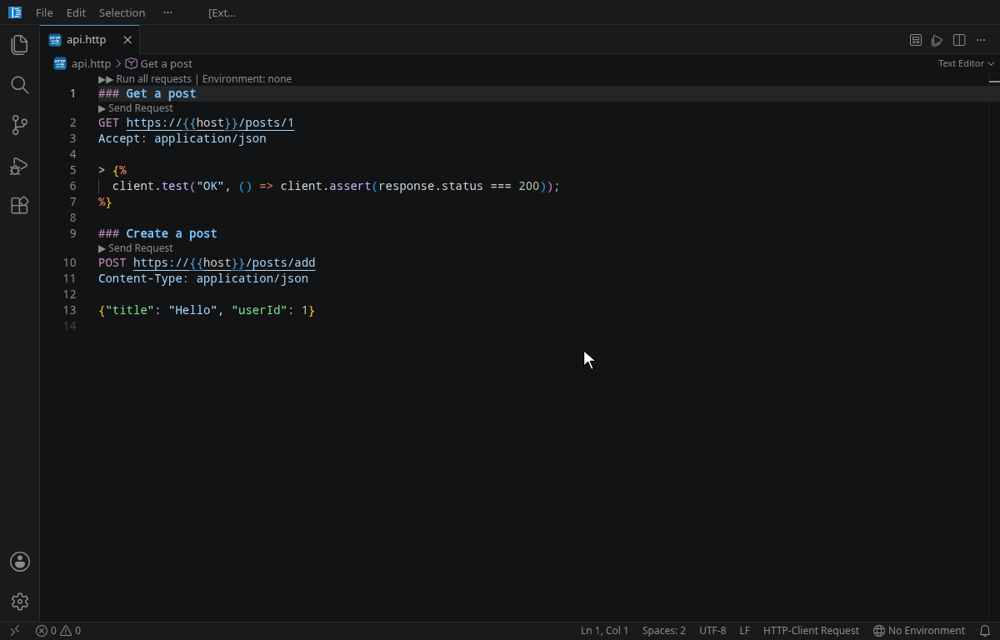

# HTTP-Client (IntelliJ style)

Runs `.http` / `.rest` files with the syntax of the **IntelliJ HTTP Client**, so existing
request files from IntelliJ/WebStorm/PhpStorm work unchanged in VS Code: environments,
`{{variables}}`, pre-request and response handler scripts, `client.test` / `client.assert`,
cookies and GraphQL.

> **Author's note:** I mainly built this extension to keep using the environment and `.http`
> files I already had for the IntelliJ HTTP Client. I mostly use it in a fire-and-forget way,
> just to send requests quickly, and that is what it is designed for.



📖 **[Full documentation](docs/documentation.md)** – request syntax, variables, environments,
scripts and the complete script API, tags, cookies, the response tab and the differences from
the IntelliJ HTTP Client.

🧪 **[Examples](examples)** – ready-to-run `.http` and environment files for every feature.

## Quick start

1. Open or create a `.http` file.
2. Click **▶ Send Request** above a request (or press `Ctrl+Alt+R`).
3. The response opens beside the editor, together with test results, script logs and the
   environment that was used.

## Example

```http
### Get a post
GET https://jsonplaceholder.typicode.com/posts/1
Accept: application/json

### Create a post
POST https://jsonplaceholder.typicode.com/posts
Content-Type: application/json

{
  "title": "Hello",
  "body": "Sent from VS Code",
  "userId": 1
}
```

## Response tab

All requests share one tab, *HTTP-Client: response*. It stays in the editor group where it is
and is updated in place; it is only brought to the front when a request fails or returns a
status of 400 or higher.

Above every response:

* **Open in viewer** opens the body in VS Code (pretty-printed JSON, images, PDFs); other binary
  content opens in the default application. The viewer always uses the same file, so its tab is
  reused and, while it is open, shows the last response of every new run.
* **Open in browser** (HTML responses only).
* **Save as…** saves the body to a file.

## File references

After `<`, `<@`, `>` and `>>`, file paths are completed relative to the `.http` file (for
response handlers `>` only `.js` files are offered). Referenced files are clickable links, and a
body file or script that does not exist is marked as an error. Paths that contain a
`{{variable}}` are not checked. When a referenced file, a `.http` file or a folder is moved or
renamed in VS Code, the paths are updated (`httpClient.updatePathsOnFileMove`).

```http
@user = janos

### Login
POST https://{{host}}/login
Content-Type: application/json

{"user": "{{user}}", "password": "{{password}}"}

> 

### Profile
GET https://{{host}}/me
Authorization: Bearer {{token}}
```

## IntelliSense

Completion (`Ctrl+Space`) and hovers depend on where the cursor is:

* **Request line:** HTTP methods (`GET`, `POST`, …, `GRAPHQL`), and after the URL the HTTP
  version (`HTTP/1.1`, `HTTP/2`).
* **`# @`:** the supported tags `name`, `no-redirect`, `no-log`, `no-cookie-jar`,
  `no-auto-encoding`, `timeout` and `connection-timeout`, with a description on hover.
* **Headers:** common header names. After choosing one, its typical values are suggested right away:
  media types for `Content-Type` and `Accept`, `Bearer` / `Basic` for `Authorization`,
  `gzip, deflate, br` for `Accept-Encoding`, … Hovering a header name explains it.
* **Scripts `< ` and `> `:** the script API with signatures and descriptions:
  `client.`, `client.global.`, `client.global.headers.`, `client.variables.`, `request.`,
  `request.headers.findByName(…).`, `response.` (only in response handlers), `response.headers.`,
  `$random.`, `jwt.`, `crypto.` including chains like
  `crypto.hmac.sha256().withTextSecret(key).digest().toHex()`, and `btoa`, `atob`,
  `URLSearchParams`, `$uuid`, `$timestamp`, `$env` … Methods are inserted with their
  arguments as a snippet. In `client.global.get("…")` the names of the global variables are
  suggested, in `request.environment.get("…")` those of the environment variables. Hover shows
  the documentation.
* **`{{`:** variables with their current value (see [Variable precedence](#variable-precedence));
  **`<`, `<@`, `>`, `>>`:** file paths (see [File references](#file-references)).

Suggestions and hovers explain what an element does – also for methods, `###`, `@name =`, header
values and the markers `<`, `>`, `>>` – and link to the matching section of the
[documentation](docs/documentation.md). **HTTP-Client: Open Documentation** opens it in VS Code.

## Keyboard shortcuts

| Shortcut (macOS: `Cmd` instead of `Ctrl`) | Command | Where |
| --- | --- | --- |
| `Ctrl+Alt+R` | Send the request at the cursor | `.http` files |
| `Ctrl+Alt+Shift+R` | Run all requests in the file | `.http` files |
| `Ctrl+Alt+Shift+L` | **Resend last request** | everywhere |
| `Ctrl+Alt+Shift+V` | **Pick and send** another request of the current / last-used file | everywhere |
| `Ctrl+Alt+Shift+E` | **Select environment** | everywhere |

The global shortcuts work from any editor, e.g. while you are editing the code that serves
the request. All shortcuts can be changed in *Preferences: Open Keyboard Shortcuts*.

* **Resend** repeats the last single request or the last “run all”. The file is re-read, so
  edits are picked up. The last request is remembered per workspace, also after a restart.
* **Pick and send** lists all requests of the active `.http` file – or, if none is active, of
  the file of the last request. The last sent request is marked; the picked one becomes the
  new “last request”.
* **Outline:** the requests of a `.http` file are shown in the *Outline* view, in the
  breadcrumbs and in *Go to Symbol in Editor* (`Ctrl+Shift+O`) – by name, title or
  method and URL.

## Commands

All commands are in the Command Palette under **HTTP-Client**:
*Send Request*, *Run All Requests in File*, *Resend Last Request*, *Pick and Send Request…*,
*Select Environment*, *Copy Request as cURL*, *Create Environment File*,
*Show Global Variables*, *Clear Global Variables*, *Clear Cookies*, *Open Documentation*.

## Environments

Environments are read from `http-client.env.json` and `http-client.private.env.json`
(searched upward from the `.http` file to the workspace root). Values in `$shared` apply to
all environments; the private file overrides the public one.

```json
{
  "$shared": { "user": "janos" },
  "dev":  { "host": "localhost:8080" },
  "prod": { "host": "api.example.com" }
}
```

* Select the environment via the status bar (in `.http` files) or `Ctrl+Alt+Shift+E`.
* The selection is remembered **per workspace** and applies to all `.http` files in it.
* Every response shows the environment it was run with (`// Environment: dev`). If the
  selected environment does not exist for a file, the request runs without one and the
  response says so.
* Keep `http-client.private.env.json` out of version control.

## Settings

| Setting | Default | Description |
| --- | --- | --- |
| `httpClient.saveAllBeforeRequest` | `true` | Save all modified files before a request is sent (untitled files are not saved). |
| `httpClient.timeoutSeconds` | `60` | Request timeout; per request `# @timeout 30`. |
| `httpClient.followRedirects` | `true` | Follow redirects; per request `# @no-redirect`. |
| `httpClient.responseViewColumn` | `beside` | Show the response `beside` the editor or in the `active` column. |
| `httpClient.updatePathsOnFileMove` | `prompt` | Update the paths after `<`, `<@`, `>` and `>>` when files or folders are moved or renamed: `prompt`, `always` or `never`. |
| `httpClient.prettyPrintJson` | `true` | Pretty-print JSON responses. |

## Supported IntelliJ features

| IntelliJ feature | Supported |
| --- | --- |
| `###` separators, `# @name` / `# @name = …`, comments (`#`, `//`) | ✓ |
| Short form without method (`https://example.com` = `GET`), `HTTP/1.1` / `HTTP/2` after the URL | ✓ (the version is not enforced; Node's `fetch` uses HTTP/1.1) |
| `▶ Send Request` per request, *Run all requests* | ✓ CodeLens, context menu, shortcuts |
| `http-client.env.json` + `http-client.private.env.json` (incl. `$shared`) | ✓ |
| `{{variables}}`, in-place variables `@name = value` | ✓ incl. completion and hover |
| Completion of methods, headers, header values, tags and the script API | ✓ incl. hover |
| Dynamic variables `{{$uuid}}`, `{{$timestamp}}`, `{{$isoTimestamp}}`, `{{$randomInt}}`, `{{$random.integer(a,b)}}`, `{{$random.alphabetic(n)}}`, `{{$random.email}}` …, `{{$env.NAME}}`, `{{$projectRoot}}` | ✓ (in scripts without braces: `$uuid`, `$env.USER` …) |
| Pre-request scripts `< ` / `< script.js` with `request.variables.set()` | ✓ |
| Response handlers `> ` / `> handler.js` | ✓ |
| `client.global.set/get/clear/clearAll/isEmpty`, `client.test`, `client.assert`, `client.log`, `client.exit` | ✓ globals persist per workspace |
| `client.global.headers.set/clear` | ✓ for the session |
| `client.variables.global/file/request/environment` | ✓ |
| `request.url` / `request.body` (`getRaw()`, `tryGetSubstituted()`, or called: `request.url()`), `request.headers.all()/findByName()` | ✓ |
| `response.status/body/headers.valueOf()/valuesOf()/contentType`, `response.cookies()/cookiesByName()` | ✓ |
| `jsonPath()`, `$random`, `crypto.sha256()…` / `crypto.hmac.sha256()…` / `crypto.hmac.sha3('512')…` | ✓ |
| `jwt.sign/verify/decode` (HS*, RS*, PS*, ES* with PEM keys) | ✓ |
| `btoa`/`atob` (also `Window.btoa`), `URLSearchParams`, `console.log` | ✓ |
| `Authorization: Basic user password` (encoded automatically) | ✓ |
| Multi-line query (indented `?a=1` / `&b=2` lines) | ✓ |
| Body from file `< ./file`, with variables `<@ ./file` | ✓ |
| Save response `>> file` (adds `-1`, `-2` …) / `>>! file` (overwrite) | ✓ |
| Multipart (`multipart/form-data`) incl. file parts | ✓ |
| `# @no-redirect`, `# @no-cookie-jar`, `# @timeout 30` (`ms`, `s`, `m`) | ✓ |
| `# @no-log` | ✓ the request is not written to the log |
| `# @no-auto-encoding` (query is percent-encoded by default) | ✓ |
| `# @connection-timeout 2 m` | ✓ limits the time until the response headers arrive |
| Cookie jar | ✓ in memory + per workspace |
| `GRAPHQL` requests (+ JSON variables block) | ✓ |
| Live templates `gtr`, `gtrp`, `ptr`, `ptrp`, `mptr`, `fptr` | ✓ (+ `rh`, `prs`, `gqlr`) |
| Copy as cURL | ✓ |
| WebSocket / gRPC requests, `import` / `run #name`, shared scripts `=`, response history in `.idea` | – |
| Collections in variables (`{{users[*].name}}`, `request.iteration()`, `request.templateValue()`) | – |
| `Authorization: Digest user password`, OAuth 2.0 (`{{$auth.token(…)}}`) | – |
| `crypto.subtle`, DOM / XML response bodies (`DOMParser`), streams (`onEachLine`), `exec`/`execSync`, `sleep`/`setTimeout`, faker variables (`$random.address` …) | – |

### Variable precedence

If a name is defined more than once, the first of these wins, as in the IntelliJ HTTP Client:
environment → `client.global` → in-place file variables `@name = value` → `request.variables`
(pre-request script).

## Notes

* The [full documentation](docs/documentation.md) describes every feature in detail.
* Uses the language id `http-client`. If *REST Client* (humao) or *httpYac* are installed too,
  they also claim `.http`; disable them or pick **HTTP-Client Request** as language mode.
* Not affiliated with JetBrains. IntelliJ is a trademark of JetBrains s.r.o.

## License

[MIT](LICENSE)
